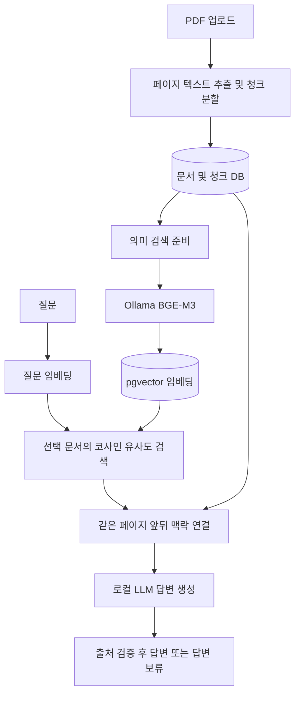

# AI Document Assistant

PDF를 업로드하고 질문하면 관련 원문을 검색해 **로컬 AI 답변과 PDF 출처 페이지**를 보여주는 Java/Spring Boot 문서 도우미입니다.

키워드 검색에서 찾지 못한 질문을 의미 검색으로 개선하고, 잘린 검색 구간에 앞뒤 맥락을 붙여 답변에 활용하도록 발전시켰습니다. 현재는 개인 PC에서 실행하는 포트폴리오용 MVP입니다.

## 주요 기능

- PDF 업로드, PDFBox 페이지별 텍스트 추출, 800자 청크·150자 중복 분할
- 문서 정보와 청크의 트랜잭션 저장, 선택한 문서 안에서 검색
- 키워드 검색과 BGE-M3·pgvector 의미 검색
- 기존 문서를 재업로드하지 않고 임베딩 생성·재색인
- 검색 구간의 같은 페이지 앞뒤 맥락 연결 및 중복 제거
- Ollama를 통한 답변 생성, 서버가 검증한 출처 번호와 PDF 링크 제공
- 근거 부족 시 답변 보류, AI 미설정 시 원문 결과로 구분
- 손상된 PDF·스캔 PDF·잘못된 경로·모델 오류 처리

## 기술 구성

| 영역 | 기술 |
|---|---|
| 서버 | Java 21, Spring Boot 4.1.1, Spring JDBC |
| 문서 처리 | Apache PDFBox 3.0.8 |
| 저장소 | H2 또는 PostgreSQL 16 + pgvector |
| 임베딩 | Ollama `bge-m3:567m`, 1024차원 |
| 답변 모델 | Ollama `qwen3:4b-instruct`로 수동 검증 |
| 화면 | HTML, CSS, JavaScript |
| 검증 | JUnit, HTTP 통합 테스트, GitHub Actions 설정 |

## 동작 구조



## 실행: 기본 검색 모드

Java 21과 `JAVA_HOME`을 준비합니다. 아래 명령은 Windows PowerShell 기준입니다.

```powershell
git clone https://github.com/HanKangHyun/ai-document-assistant.git
cd ai-document-assistant
.\start.ps1
```

브라우저에서 [localhost:8080](http://localhost:8080)을 엽니다. 기본 설정은 H2 파일 DB와 키워드 검색으로, Docker와 AI 모델 없이 실행됩니다. 이전 터미널에서 AI·의미 검색을 켰다면 `AI_ENABLED=false`, `SEMANTIC_ENABLED=false`로 설정하거나 새 터미널을 사용하세요.

## 실행: 의미 검색 + 로컬 AI

1. Java 21, Docker Desktop, Ollama를 설치하고 Docker·Ollama를 실행합니다.
2. `.env.example`을 `.env`로 복사하고 `POSTGRES_PASSWORD`를 로컬 비밀번호로 변경합니다. 기존 `.env`가 있으면 재사용합니다.
3. 모델을 다운로드하고 서버를 실행합니다.

```powershell
ollama pull bge-m3:567m
ollama pull qwen3:4b-instruct
$env:AI_ENABLED='true'
$env:OLLAMA_MODEL='qwen3:4b-instruct'
.\start.ps1 -Profile postgres -Semantic
```

화면에서 **PDF 업로드 → 문서 선택 → 의미 검색 준비 → 질문** 순서로 사용합니다. 위 검색창은 키워드 검색, 질문창은 의미 검색으로 동작합니다. 이미 준비된 문서는 서버 재시작 후에도 임베딩을 재사용합니다.

H2와 PostgreSQL은 별도 DB입니다. H2에서 PostgreSQL로 전환할 때는 PDF를 다시 업로드해야 합니다. 동일 PostgreSQL 문서의 재색인에는 재업로드가 필요 없습니다.

서버 종료는 `Ctrl+C`입니다. 서버는 기본적으로 `127.0.0.1:8080`, Ollama는 `127.0.0.1:11434`를 사용합니다. PDF는 `uploads/`, H2는 `data/`, PostgreSQL 데이터는 Docker 볼륨에 저장됩니다. `.env`는 PostgreSQL 계정 설정에 사용되며, AI 설정은 위 환경 변수로 전달합니다.

## 문제 해결 사례

질문: **“사람이 반복하던 작업을 줄인 사례를 설명해 주세요.”**

| 단계 | 수동 확인 결과 |
|---|---|
| 키워드 검색 | 문서의 배포 자동화 내용과 질문의 표현이 달라 관련 구간을 찾지 못함 |
| 벡터 검색 | 관련 구간을 찾았지만 문장이 잘린 상태여서 모델이 답변을 보류함 |
| 맥락·프롬프트 보완 | 같은 페이지 인접 구간을 연결하고 의미상 근거를 활용하도록 개선 후 배포 자동화 사례와 출처 페이지를 반환 |
| 답변 불가 확인 | 문서에 없는 희망 연봉 질문은 답변 보류 |

이는 한 문서에서 확인한 사례이며 전체 정확도나 개선율을 의미하지 않습니다. [검색 설계](SEMANTIC_SEARCH.md)와 [검증 상태·후속 과제](PROGRESS.md)를 참고하세요.

## 테스트

```powershell
.\gradlew.bat test bootJar --no-daemon
```

기본 테스트는 메모리 H2·임시 업로드 폴더·모의 AI 서버를 사용합니다. 실제 모델의 정확도 평가는 별도입니다.
PostgreSQL 테스트는 `PGVECTOR_TEST_URL`, `POSTGRES_USER`, `POSTGRES_PASSWORD`를 환경 변수로 설정하면 실행됩니다. 예: `PGVECTOR_TEST_URL=jdbc:postgresql://localhost:5432/aidocument`. `.env`는 Gradle이 자동으로 읽지 않습니다. PostgreSQL 테스트는 전용 임시 스키마를 생성·삭제하므로 개발용 DB에서 실행하세요.

최근 확인: 관련 자동 테스트 **23개 통과**, 실행용 JAR 빌드 성공. 전체 테스트 최종 실행은 테스트 도구의 프로세스 연결 권한 문제로 미완료입니다. PostgreSQL 통합 테스트와 GitHub Actions 설정은 포함했으나 이 기록만으로 전체 테스트 또는 CI 성공을 주장하지 않습니다.

## 주요 API

| 요청 | 기능 |
|---|---|
| `POST /api/documents/upload` | multipart `file` PDF 업로드 |
| `GET /api/documents` | 문서 목록 |
| `GET /api/documents/{id}/search?q=키워드` | 키워드 검색 |
| `GET /api/documents/{id}/index` | 의미 검색 준비 상태 |
| `POST /api/documents/{id}/index` | 임베딩 생성·재색인 |
| `GET /api/documents/{id}/semantic-search?q=질문` | 의미 검색 결과·유사도 |
| `POST /api/documents/{id}/ask` | JSON `{"question":"질문"}`으로 답변 요청 |
| `GET /api/documents/{id}/pdf` | 원본 PDF |

## 한계와 후속 과제

- 인증·사용자별 접근 제어가 없는 로컬 개발 버전입니다. 공개 서비스 배포는 아직 하지 않았습니다.
- 스캔 PDF OCR, 문서 삭제, 비동기 색인 작업 큐는 미구현입니다.
- 출처 ID 검증이 답변의 의미적 정확성까지 보장하지는 않습니다.
- 질문 20개 이상에 대한 정답 페이지·답변 보류·응답 시간 평가를 준비할 예정입니다. 현재 정확도·지연 시간 수치는 공개하지 않습니다.
- 공개 시연에는 개인정보·회사 내부 정보가 없는 문서를 사용하세요.
